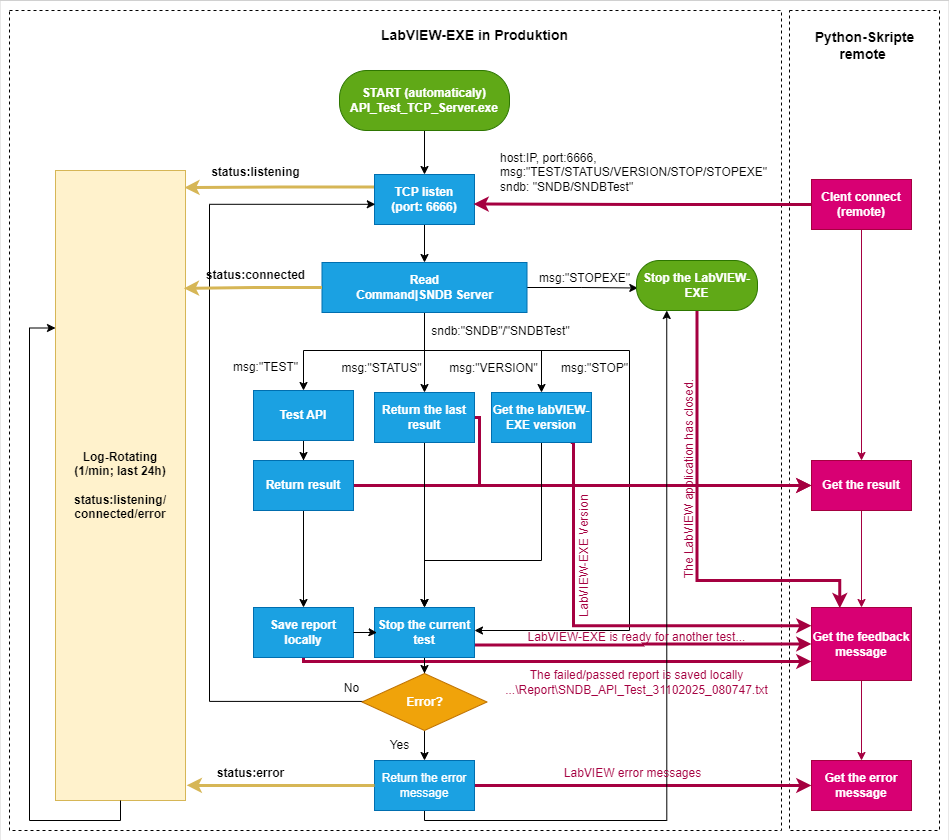
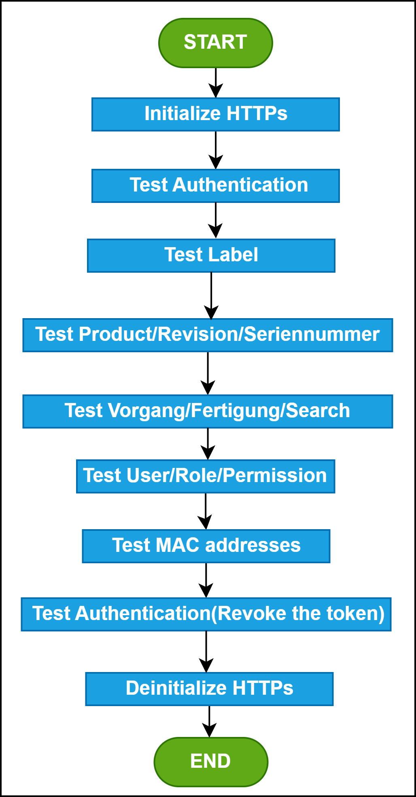
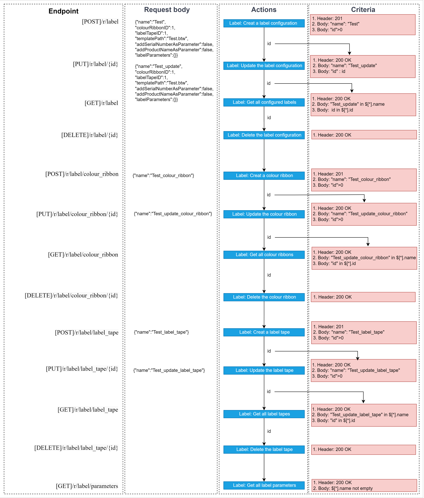
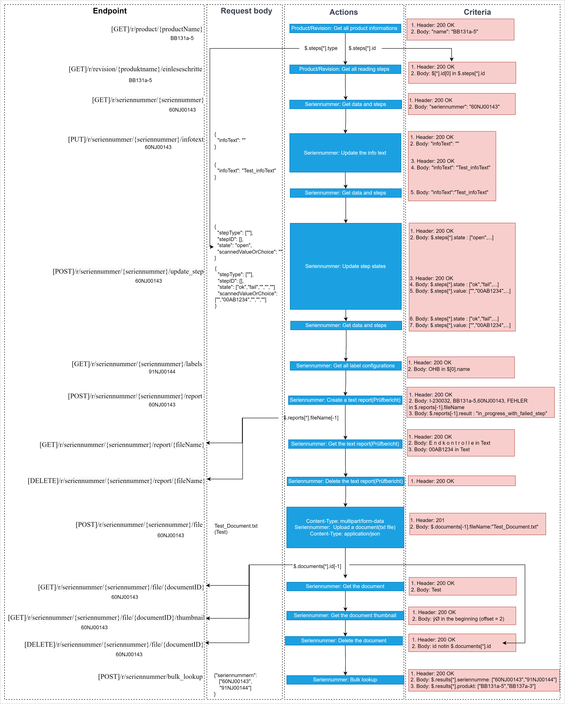
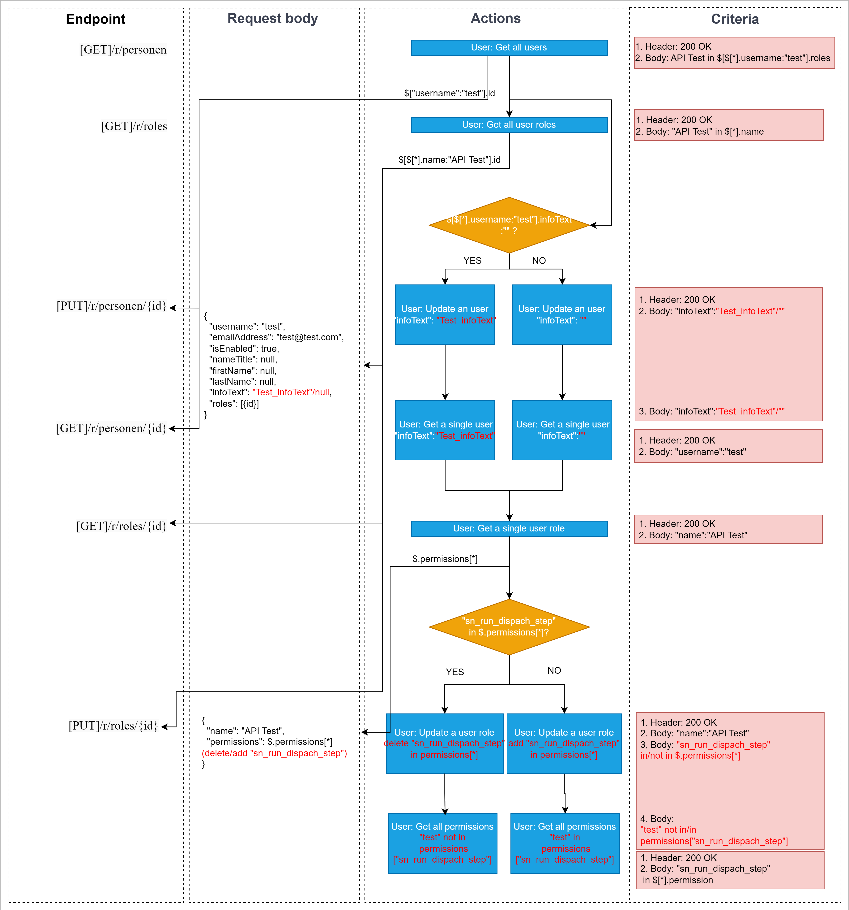
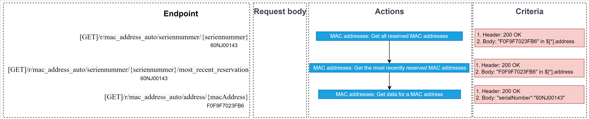

[README.md](https://github.com/user-attachments/files/34799397/README.md)
# SNDB API Linux

LabVIEW-basiertes Testsystem für die SNDB-API mit einem Python-Client zur Fernsteuerung über TCP. Der LabVIEW-Server führt API-Tests aus, speichert Berichte lokal und liefert Ergebnisse an den Client zurück.

Ziel ist ein dauerhaft im Hintergrund laufender Testserver, dessen API-Tests nach dem Deployment von API-Änderungen automatisch ausgelöst werden.

## Aufbau und Ablauf

```text
Python-Client → TCP-Port 6666 → LabVIEW-Testserver → SNDB / SNDBTest
                                      ↓
                              Testberichte und Logs
```

1. Der LabVIEW-Testserver wartet auf eine TCP-Verbindung.
2. Der Client sendet einen Befehl und die gewünschte SNDB-Umgebung.
3. Bei `TEST` führt der Server die API-Testgruppen aus und speichert einen Bericht.
4. Der Server liefert das Ergebnis beziehungsweise eine Fehlermeldung zurück.



*Kommunikationsablauf aus der Projektdokumentation. Das dargestellte Log-Intervall von einer Minute weicht von der aktuellen Konfigurationsdatei ab.*

Die Ablaufdiagramme dokumentieren Tests für:

- Authentifizierung einschließlich Erstellen und Widerrufen eines Tokens
- Produkte, Revisionen und Seriennummern
- Labels, Farbbänder und Etikettenbänder
- Vorgänge, Fertigmeldungen und Suche
- Benutzer, Rollen und Berechtigungen
- MAC-Adressen

Die Tests enthalten schreibende und löschende API-Aufrufe, unter anderem Änderungen an Seriennummern, Rollen und Vorgängen. Für einen Testlauf muss die Zielumgebung bewusst gewählt werden.

## Projektstruktur

| Pfad | Inhalt |
| --- | --- |
| `LabVIEW/SNDB_API_Test.lvproj` | LabVIEW-Projekt und Build-Spezifikation |
| `LabVIEW/LabVIEW.Main/` | TCP-Server, Testablauf, Hauptprogramm und Statusabfrage |
| `LabVIEW/LabVIEW.HTTPs_Client/` | SNDB-Kommunikation, Testgruppen, Zertifikat und Testdateien |
| `LabVIEW/LabVIEW.Library/` | Bibliothek und Wrapper für die SNDB-Kommunikation |
| `LabVIEW/LabVIEW.FGV/` | VIs zur Speicherung von IDs und Ergebnissen |
| `LabVIEW/LabVIEW.Service/` | Hilfsfunktionen für JSON, Konfiguration, Berichte, Logging und Zeitsteuerung |
| `LabVIEW/LabVIEW.Type Definitions/` | LabVIEW-Typdefinitionen für Befehle |
| `Python/Python.API_Test_TCP_Client.py` | Python-TCP-Client |
| `Python/deploy.py` | Separates Deployment-Skript für die Serverumgebung |
| `builds/SNDB_API_Test/API_Test_TCP_Server/` | Vorhandene Build-Artefakte, Konfiguration, Testdateien und Logs |
| `Doc/` | draw.io-Ablaufdiagramme und PNG-Exporte |
| `Report/Reports/` | Vorhandene Testberichte |

## Voraussetzungen

### LabVIEW-Server

- Zum Bearbeiten und Bauen: eine mit dem Projekt kompatible LabVIEW-Installation.
- Zum Ausführen eines Builds: eine zum Build und zur Plattform passende LabVIEW-Runtime sowie dessen benötigte Abhängigkeiten.
- Netzwerkzugriff auf die gewählte SNDB-Umgebung und passende API-Zugangsdaten.
- Schreibbare Verzeichnisse für Berichte und Logs.


### Python-Client

Python 3 und das Paket `tqdm`:

```sh
python -m pip install tqdm
```

`socket`, `struct` und `time` gehören zur Python-Standardbibliothek. Eine zentrale Python-Abhängigkeitsdatei ist derzeit nicht enthalten.

## Server starten

Auf Linux: `builds/SNDB_API_Test/API_Test_TCP_Server/` starten. 
Auf Windows: `builds/SNDB_API_Test/API_Test_TCP_Server.exe/` starten. 

## Python-Client verwenden

Die Funktion hat folgende Signatur:

```python
test_sndb_api(host: str, port: int = 6666, msg: str = "", sndb: str = "") -> str
```

Da der Dateiname Punkte enthält, kann der Client beispielsweise mit `runpy` geladen werden. Dieses Beispiel aus dem Projektverzeichnis fragt zunächst nur die Version ab:

```python
import runpy

client = runpy.run_path("Python/Python.API_Test_TCP_Client.py")
request = client["test_sndb_api"]

print(request("localhost", 6666, "VERSION", "SNDBTest"))

# Bewusst auszulösender Testlauf auf der Testumgebung:
# print(request("localhost", 6666, "TEST", "SNDBTest"))

# Zuletzt gespeichertes Ergebnis abfragen:
# print(request("localhost", 6666, "STATUS", "SNDBTest"))
```

Das Ziel `SNDB` bezeichnet die produktive Umgebung; `SNDBTest` bezeichnet die Testumgebung. Der Client hat derzeit keine Kommandozeilenargumente.

### TCP-Befehle

| Befehl | Dokumentierte Funktion |
| --- | --- |
| `TEST` | API-Test ausführen, Bericht speichern und Ergebnis liefern |
| `STATUS` | Letztes Ergebnis zurückgeben |
| `VERSION` | Version der LabVIEW-Anwendung abfragen |
| `STOP` | Aktuellen Test stoppen |
| `STOPEXE` | LabVIEW-Anwendung beenden |

### Nachrichtenformat

Der Python-Client sendet:

1. Vier Byte Nachrichtenlänge als vorzeichenlose Ganzzahl in Netzwerk-Byte-Reihenfolge (`struct.pack("!I", ...)`).
2. Den UTF-8-kodierten Text `BEFEHL|UMGEBUNG`, beispielsweise `TEST|SNDBTest`.

Die Antwort liest der Client in Blöcken von bis zu 4096 Byte bis zum Schließen der Verbindung durch den Server und dekodiert sie mit `latin-1`. Ausnahmen werden als Text mit dem Präfix `Fehler:` zurückgegeben.

Bei `TEST` wartet der Client zunächst fest 60 Sekunden und zeigt einen Fortschrittsbalken an. Dieser Balken zeigt die Wartezeit, nicht den tatsächlichen Fortschritt des Servers. Socket-Timeouts sind nicht gesetzt; ein ausbleibendes Verbindungsende kann die Antwortabfrage blockieren.

## Konfiguration

Die mitgelieferte Datei `builds/SNDB_API_Test/API_Test_TCP_Server/config.ini` enthält:

```ini
[Settings]
port = 6666
log_folder_path = ""
result_folder_path = ""
period_of_log_rotating[ms] = 600000
time_of_log_rotating[ms] = 86400000
```

| Einstellung | Bedeutung |
| --- | --- |
| `port` | TCP-Port des Testservers |
| `log_folder_path` | Pfadangabe für Logs; im mitgelieferten Stand leer |
| `result_folder_path` | Pfadangabe für Ergebnisse; im mitgelieferten Stand leer |
| `period_of_log_rotating[ms]` | Parameter der Log-Rotation: 600000 ms entsprechen 10 Minuten |
| `time_of_log_rotating[ms]` | Parameter der Log-Rotation: 86400000 ms entsprechen 24 Stunden |

Die genaue Behandlung leerer Pfade und die Rotationslogik liegen in den LabVIEW-VIs. Das TCP-Ablaufdiagramm nennt ein anderes Rotationsintervall als die mitgelieferte Konfiguration; die Werte sollten beim Einrichten abgeglichen werden.

Der Confluence-Export beschreibt `Reports/` und `Logs/` unter dem EXE-Verzeichnis als Standardablage und verwendet explizite Windows-Pfade für `result_folder_path` und `log_folder_path`. Diese Pfade müssen zur jeweiligen Installation passen. Als Rotationsintervall nennt er `60000` ms (eine Minute), als Aufbewahrungszeit `86400000` ms (24 Stunden). Zusätzlich nennt er für `time_of_log_rotating[ms]` die Grenze `< 4294967290`.

Weitere `.ini`- und `.conf`-Dateien im Build-Verzeichnis enthalten LabVIEW-Laufzeiteinstellungen.

## Berichte und Dokumentation

Die vorhandenen Berichte unter `Report/Reports/` enthalten fehlgeschlagene Prüfschritte mit URL, Request, HTTP-Antwort und Testergebnis. Ein HTTP-Status `200` allein bedeutet nicht, dass die fachliche Prüfung bestanden wurde. Die Berichte enthalten auch Authentifizierungs-Header und sollten vor einer Weitergabe bereinigt werden.

Wichtige Ablaufdiagramme:

- [TCP-Kommunikation](Doc/TCP_Communication_Flowchart.drawio)
- [Reihenfolge der Testgruppen](Doc/API_Test_Group_Flowchart.drawio)
- [API-Testablauf](Doc/API_Test_Flowchart.drawio)

Weitere Diagramme beschreiben die einzelnen Testgruppen, Requests und erwarteten Ergebnisse.

### Ergebnis und Bericht

Laut Projektdokumentation kann die Client-Antwort Testergebnis, Speicherhinweis, Bereitschaftsmeldung und LabVIEW-Fehlertext kombinieren. Ein erfolgreicher Test liefert beispielsweise:

```text
Result: Passed
```

Bei einem fehlgeschlagenen Prüfschritt enthält die Antwort den Namen der API-Operation, URL, Request-Body, Header, Antwort-Body und `Result: Failed`. Authentifizierungswerte werden hier bewusst nicht als Beispiel übernommen.

Das dokumentierte Dateinamenschema lautet `SNDB_API_Test_{Datum}_{Uhrzeit}.txt`, beispielsweise `SNDB_API_Test_31102025_080747.txt`. Die vorhandenen Berichte im Projekt verwenden dagegen Namen wie `SNDBTest_Server_08122025_142830.txt`; das Schema kann somit je nach Stand abweichen.

Der Export ist bei der Speicherbedingung uneinheitlich: Die Befehlstabelle nennt das Speichern bei Fehlern, der Abschnitt zu Ergebnissen und die Feedback-Tabelle beschreiben Berichte für bestandene und fehlgeschlagene Tests. Das tatsächliche Verhalten muss am verwendeten Build geprüft werden.

### Rückmeldungen des Servers

| Rückmeldung | Bedeutung |
| --- | --- |
| `The failed/passed report is saved locally` | Bericht wurde gespeichert; die Antwort kann den Ablagepfad enthalten. |
| `The failed/passed report cannot be saved locally` | Bericht konnte nicht gespeichert werden, etwa wegen fehlender Schreibrechte oder fehlgeschlagener Dateierstellung. |
| Versions- und Herstellerinformationen | Antwort auf `VERSION`; die Dokumentation zeigt beispielhaft Version `1.0`. |
| `LabVIEW-EXE is ready for another test...` | Server ist für weitere Befehle bereit. |
| `The LabVIEW application has closed.` | Anwendung wurde mit `STOPEXE` beendet und muss für weitere Tests erneut gestartet werden. |
| LabVIEW-Fehlertext | Serverseitiges Problem; Fehlercode und Beschreibung dienen der Diagnose. |

### Rotierende Zustandsprotokolle

Die dokumentierten Log-Einträge enthalten Zeitstempel, `status`, `command`, `description` und `vi callers list`.

| Zustand | Bedeutung |
| --- | --- |
| `listening` | Server wartet auf eine Verbindung. |
| `connected` | Client ist verbunden; `command` enthält beispielsweise `TEST|SNDBTest`. |
| `error` | Laufzeitfehler; `description` enthält die Fehlerdetails. Der Export beschreibt hierfür einen Neustart des Servers. |

## Testgruppen und Ablaufdiagramme

Die folgenden acht eingebundenen Bilder einschließlich des Kommunikationsdiagramms stammen aus dem bereitgestellten Confluence-Export. Sie sind bytegleich mit den PNG-Dateien in `Doc/`. Die großen Detaildiagramme lassen sich über den jeweiligen Link in Originalgröße öffnen.

### Reihenfolge der Testgruppen

Nach der Initialisierung folgen Authentifizierung, Labels, Produkte/Revisionen/Seriennummern, Vorgänge/Fertigung/Suche, Benutzer/Rollen/Rechte und MAC-Adressen. Abschließend wird der Token widerrufen und die HTTPs-Verbindung deinitialisiert.



### Authentifizierung

Erstellen und Prüfen von API-Tokens sowie deren Widerruf am Ende des Testablaufs.

[](Doc/Test_%20Authentication_Flowchart.png)

### Labels

Anlegen, Ändern, Abfragen und Löschen von Label-Konfigurationen, Farbbändern und Etikettenbändern sowie Abfragen der Label-Parameter.

[](Doc/Test_Label_Flowchart.png)

### Produkte, Revisionen und Seriennummern

Produktinformationen und Einleseschritte, Seriennummerndaten, Schrittzustände, Prüfberichte, Dokumente und Sammelabfragen.

[](Doc/Test_Product_Revision_Seriennummer_Flowchart.png)

### Vorgänge, Fertigung und Suche

Vorgangsdaten, Seriennummernzuordnung, Revisionen, Prüfprotokolle, CSV-/XLSX-Exporte, Fertigmeldungen und deren Rücknahme sowie Suchfunktionen.

[](Doc/Test_Vorgang_Fertigung_Search_Flowchart.png)

### Benutzer, Rollen und Berechtigungen

Abfragen und Änderungen von Benutzerdaten und Rollen sowie die Prüfung zugehöriger Berechtigungen.

[](Doc/Test_User_Role_Permission_Flowchart.png)

### MAC-Adressen

Das folgende Diagramm beschreibt die Prüfschritte für MAC-Adressen.

[](Doc/Test_MAC_addresses_Flowchart.png)

### Dokumentierte Testdaten

Der Export nennt das Testkonto `test` mit der Rolle `API Test`. Das Passwort ist dort maskiert und muss über die zuständige Administration bereitgestellt werden.

| Seriennummer | Produkt/Revision | Vorgang laut Export |
| --- | --- | --- |
| `60NJ00143` | `BB131a-5` | `I-230032` |
| `90NJ00999` | `BB131a-4` | `I-230032` |
| `91NJ00144` | `BB137a-3` | `I-250027` |

Für `60NJ00143` sind die MAC-Adressen `F0F9F7023FB3`, `F0F9F7023FB4`, `F0F9F7023FB5`, `F0F9F7023FB6`, `F0F9F7023FB7` und `F0F9F7023FB8` dokumentiert. Diese Angaben beschreiben Testvoraussetzungen aus dem Export, keinen verifizierten aktuellen Datenbankzustand. Tests können die Zuordnung zu Vorgängen und Revisionen verändern.

Die im Export erwähnte Excel-Datei zur Testabdeckung ist nicht als Bestandteil des Exports eingebettet. Eine vollständige Abdeckungsmatrix lässt sich daraus nicht übernehmen.

## Bekannte Mängel laut Projektdokumentation

- Die Historienanzeige wächst kontinuierlich und kann die Anwendung verlangsamen sowie die Anzeige fehlgeschlagener Tests verlängern.
- CSV-Dateien aus Fertigmeldung und Rücknahme lassen sich laut Dokumentation derzeit nicht löschen.
- Der dauerhafte Hintergrundbetrieb des LabVIEW-Servers kann insbesondere bei parallelen Prozessen die Systemleistung beeinträchtigen.

Diese Punkte stammen aus dem bereitgestellten Dokument und wurden nicht durch einen aktuellen Testlauf bestätigt. Zusätzlich gelten die oben beschriebenen Einschränkungen des Python-Clients: feste Wartezeit, fehlende Socket-Timeouts und ein direkter Start gegen die produktive Umgebung.

## Deployment-Skript

`Python/deploy.py` gehört zu einer umfassenderen Serverumgebung. Es verwendet externe `python_helper`-Module, eine initialisierte `.env`-Konfiguration, GitHub-Zugriff und Docker Compose. Diese Umgebung ist hier nicht vollständig enthalten; das Skript ist daher aus diesem Verzeichnis allein nicht einsatzbereit.

Der implementierte Ablauf umfasst die Auswahl eines Dienstes und Container-Tags, eine interaktive Bestätigung, ein Datenbank-Backup in Produktion, die Aktualisierung der Version in `.env`, das Herunterladen und Starten der Container sowie bedingte SNDB-Datenbankmigrationen und Deployment-Meldungen an GitHub.

## Grenzen dieser Dokumentation

Diese Beschreibung kombiniert den Python-Quellcode, die LabVIEW-Projektmetadaten, Konfigurationsdateien, Ablaufdiagramme und vorhandenen Berichte mit dem bereitgestellten Dokument `SNDB+-+API-Test.doc` (Confluence-Export vom 13. November 2026). Die binären `.vi`- und `.ctl`-Dateien wurden nicht auf Blockdiagramm-Ebene geprüft. Dokumentierte LabVIEW-Abläufe sind deshalb keine Bestätigung des aktuellen Laufzeitverhaltens. Für die Erstellung dieser README wurden keine API-Tests und kein Deployment ausgeführt.
